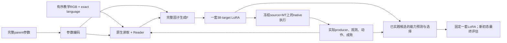

# 从实际控制缺口学习完整LoRA：当前优先设计

2026-10-13。**完整方法已选定；§12完整G控制学习已验收并经主讨论科学消费；§13固定输入函数回读已完成并科学消费；§14同T完整BA与native有界两臂及全部末点已完成工程验收，交主讨论按事前合同科学裁决。当前没有active计算或自动后继，完整方法尚未充分训练与验证。§11接手阴性及独立审阅保持，失败恢复监督已撤下；原§23固定G/θ批已完成并经主讨论科学消费，实际裁决见§10。**
此前称其已经定稿、只需等待§23的判断撤回。§23由实验session独立执行；完成后按实际相关性纳入，不作为本次重审的等待门槛。
问题与原始证据见
[主分析](../analyses/problem_first_method_audit_20261013.md)。[独立审阅及修订](../analyses/problem_first_method_review_20261013.md)
记录已修正的问题与仍存在的反例。Goal重设后已选定单T完整函数蒸馏和独立BCE价值学习；
不用局部混合动作目标追求未获证据的能力并集。当前重心是让完整G学会正常成功控制的跨任务编译，
而非假设共同E能纠正学生已进入的失败状态；新任务迁移仍须由完整方法实证。

## 1. 要改变的失败预测

当前已确认：首G在训练域有强控制能力，但跨任务增益小且不均匀；更多实践没有净增益；
G的后期目标是共同专家的BA距离、读取前端冻结在单MT parent/单episode覆盖，而真实query回报主要教θ。
另有两项必须保留的反证：共同E本身可以是正确学习目标；固定F改native-FM曾使held165→158。

本设计的主假说是：**在已有强初始编译器上，以同一目标控制器的正常成功执行和跨episode控制查询，
共同训练完整读取—写入链，使其学习实际动作功能并检验已有成功的保持；不能长期用全局参数距离替代这项能力学习。**
§11诊断表明，原登记8个失败访态的P/E/T接手均未成功，故不再把现成E的失败恢复标签当作这一假说的支撑。
修正首先检验首G控制映射与跨任务能力；自身H仍作为条件，但实践修订能否增加能力保留为单独的实证问题。
若完整学习仍没有改善训练任务的控制/保持，或只在训练任务改善而新任务持续无增益，
本假说分别在获取、迁移层面受否定。不能仅凭功能误差下降继续投入。

这没有唯一归因当前低分：映射数量、source先验和F外推仍是竞争解释；本候选也没有消灭任务识别捷径。
主讨论选择它作为继续改变G的优先方案；实际下一投入仍消费§23，不能把“更新目标更贴近行为”写成已经解决总体性能。

## 2. 完整部署流程及参数所有权

本文件将合并MT基底、38-target rank8残差这一分支具体化，source基础权重始终冻结。
这不是MT相对纯source已获性能优胜证明；教师、参数族与初始化可重新准备，承接便利不能成为取舍理由。
本次优先从强G起步，是因为它直接检验已有成功、部分操作进展及失败差异为何没有转成有效修订：
这些实际经历已经存在，但读取前端未随其输入范围学习，后期G又只得到BA距离信用。
接手阴性同时限制这项理由：经历存在不等于已有正确恢复标签，也不将“修复失败”作为保留MT的已证实优势。
Source与MT起点的因果比较仍未完成，见主分析§9–12；它不阻止作出这一可撤销的科学选择。
在本MT分支内，G从较强G38349完整状态初始化，表示和F均允许在**共享训练**学习；
这不是原F-only优化器的exact-resume。部署时共享参数全部冻结，condition内没有轨迹拟合或共享参数更新。

解冻链路意味着原CP432的冻结context缓存不能作为可训练G的输入继续使用。可复用原始视频、真实H与不依赖可训练参数的
source特征；依赖meta、Reader、static的z/h或memory必须在该共享更新的图内重新计算。H中原producer的实际动作/hidden
仍是冻结的真实经历，不改造成当前P执行的记录。目标T支路独立冻结；固定T与同一查询内可复用其响应，T变化后不能沿用。
若开展§6匹配辨识，两臂从同一G权重建立新的优化器，F的初始化状态与更新规则一致，只让另一臂增加前端的梯度消费者；
不把“F沿用旧Adam、完整G重置Adam”混入所谓只解冻前端的比较。具体优化器数值和事件整数属于后续冻结的运行合同。

1. 输入exact language与K=1有序、双相机、stride5的action-hidden视频。仍用真实source/meta prefix读取z、h；
   不加fake query、teacher state、动作反演标签或task-ID输入。
2. MT先做一次真实实践。合法H保存实际producer、RGB/proprio、执行动作、native hidden与真实成败。
   维持正确的来源和final-query隔离，不把离线teacher标签补进H。暂不增加物体状态或contact输入：当前证据未证明新增这些字段能解决主要缺口。
3. Reader读取视频与实际H，static读取完整数值parent，F输出一套完整残差P。保留现有
   `P_new=P0+S F((P_parent-P0)/S,m)`；不把它改写成天然保持P的identity，也不宣称它必须做小步修订。
4. 每次提案后，实践/继续/停止策略选择有用的实际尝试；经过实践的候选才可成为最终输出。
   共享学习须覆盖首次及后续真实parent/H、成功和失败经历，不在第一次成功时永久屏蔽后续学习。
   观看次数由实践价值与登记资源预算决定，不固定为两轮或轮数菜单。
5. 从实际可用候选选出一套完整LoRA，固定后移除Writer、选择器和其它适应辅助。在未用于该condition适应的新初态
   用official十步flow、前5动作执行等原合同评估。没有多LoRA平均、按最终初态换adapter或query回流。

教学z/h只表示由合法输入产生的原生特征；不预称其已编码抓取、阶段或操作程序。
video→memory→F→BA→自身hidden→动作的路径成立，但其操作语义仍由实际行为干预证明。

图中回路是编译期真实实践产生新输入；不是对模拟器反传，也不是在新condition用动作轨迹微调P。
共享G、选择及行为模型如何学习分别由下面三项损失的参数所有权定义；最终评估没有回流边。

## 3. 共享训练中的查询与控制目标

每个训练condition先固定合法教学V和一段真实parent/H，再生成完整P。专家标签只能由独立监督消费者读取。
**先为整个condition选择一个固定目标控制器T，再产生所有功能标签**：只比较该task既有共同E与实际incoming parent，
复用/补齐同一组16个训练query初态和policy noise的真实成功数，选择成功数较多者，同分保留incoming parent。
T的选择只使用合法meta-training query，不使用validation/test结果；query和T身份不进入condition输入。
T在这个condition及其全部函数更新内固定，既不逐状态挑teacher，也不平均E与parent的动作。
这是在既有控制器间选训练目标，不按H重新训练专家；16次有限比较不冒称真实成功概率排序已被证明。
若大多数condition仍只选E，应如实报告，不能声称已获得丰富的H特异目标。

已完成的原9轮共享训练query中，113个实际候选（36 MT、77 G）与同task共同E有完全配对的16初态记录：
E较强51、持平46、parent较强16；同分保留parent会产生62个parent目标、51个E目标。
因此目标不必恒为E，但这不是113个独立任务，也不是待训练新阶段的实际覆盖。
选较高分的一方仍放弃57个“另一方成功”的候选—初态事件，具体为选E丢26、选parent丢31；
它不是联合最优或无损改进，有限16初态排序也有估计误差。完整原件与限制见主分析§8。

每个condition的功能查询由以下三类组成，**三类均使用同一T**。当前不纳入未经支持的失败恢复项。
每类先按episode、replan及有效动作维度取均值，
再对实际可用类别等权；随后condition和task按登记口径等权，不能让长视频或较多查询改变task权重。

- **T自身的正常成功执行。** 使用T在独立于教学video的合法训练初态上实际完成的episode，
  在其访问状态及原native noise上监督完整学生响应。可复用选T时实际产生的训练query中成功episode，
  原始观测与noise须真实保存；没有记录的不伪造。这提供连贯的成功控制支撑，不是学生失败状态上的接手标签。
  只从这类成功得到的状态仍可能覆盖不足，不能据此认定学生从新初态必然成功。
- **跨episode正常控制查询。** 观测来自同task但不同于teacher video episode的合法RGB/state，目标是T的完整native响应。
  本阶段不是沿用原action-label FM，而是把全局BA教师关系改为统一的控制函数蒸馏。
  这项响应是所选控制器的行为目标，不逐状态冒称最优正确动作；有限query上整体较强也不认证每个正常状态。
- **实际成功状态查询。** 来自H中真正成功episode的访问状态；只有固定T也能从该状态接手成功才加入。
  此时学习T的连贯控制函数，不混入其它成功producer的不同动作模式。

若T在登记训练query中无成功episode，相应正常成功类为空，仍保留该condition和其余合法查询，
不得补挑教学或将失败轨迹冒充成功支撑。各类缺失数和整体控制结果必须一并报告。
失败H仍由G、phi和beta读取，但没有合格控制目标的失败状态不产生动作纠错loss。
本轮不继续收集接手实例寻找正例；以后只有出现另行登记的真实恢复证据才重新讨论这一监督项。

训练目标仅为既有E或实际incoming parent；它们不作为部署dictionary、第二adapter或教学输入。
对上述真实成功状态的保持资格，若T不是原producer，须利用已保存的真实模拟器状态，
在隔离训练环境中验证该controller确能继续完成任务；
只在成功的真实接手实例上使用其功能目标；资格绑定同一snapshot、首个动作chunk的noise及后续noise流，
不能用noise1下的接手成功认证noise2下的标签。不能从“标准初态成功率高”自动推出失败访态标签正确。
同一状态的一次接手成功只证明该实例可行，不认证总体恢复成功率，也不把某次失败证明成该状态不可恢复。
接手成功也不证明此前P的首chunk错误：成功可能依赖T随后整段控制。因此若采用这项共享训练数据，
监督支撑要包括该次真实成功接手后T访问的后续状态及其同noise响应，不能只拿起始chunk当局部纠错真值。
这些是non-held共享Writer的合法功能标签，不是部署condition准备轨迹再拟合LoRA；部署没有T、目标动作或此损失。
即使蒸馏整个成功接手支撑，新P仍可能偏离该分布，所以需用新P重新实践并以独立query裁决，不能把教师成功转记为学生成功。
若T本身就是该真实成功episode的producer，且使用原noise流，已完成episode可直接提供这次资格；
不必为同一事实再跑接手。其它T在没有真实snapshot时不能补造资格。
若固定T不能完成，该状态保留为未解决失败/保持冲突，不改找另一个T补标签、不补零、不平均其它成功动作。
特别是原producer成功而T失败的状态，说明平均更强的T仍会损失局部能力；它必须进入真实保持读数。
选择T不认证所有MT成功都被保住，最终选择保留MT/已实践parent候选，也不构成新初态成功保证。

保持资格筛选也可能偏向容易状态，不能只报告有标签子集。待验访态须按事前登记、与T接手是否成功无关的
抽样规则形成；报告全部真实episode的成功/失败分布、登记成功访态数、实际接手数及有资格标签数，
无snapshot、接手失败和原producer成功而T失败分别保留。资格覆盖的分母是全部预登记待验状态，
不能在看到结果后删除无标签行。只有合格子集改善、总体控制或保持没有改善，不能称主要控制缺口已经解决。
这属于同批真实数据的消费口径，不为补百分比另开探针。

在上述训练查询的观测`o`和固定原生noise `epsilon`下，直接调用现成的
`src/ember/writer/practice/execution.py::native_actions`，分别得到`a_P(o,epsilon)`与目标controller的
`a_T(o,epsilon)`，均执行完整十步native flow并取实际会执行的5×7维动作。
各类函数项均为`mean ||a_P-a_T||²`，目标支路冻结；P支路必须穿过十次真实积分及全部38处因子，
不能detach生成P、使用固定的学生latent代替P当前去噪路径，或只比较单步velocity后称为实际动作监督。
该目标教共享Writer如何编译控制函数；新教学condition部署时没有目标动作或此项拟合。

具体作用并非“功能loss会自动理解视频”。在第j次native flow调用，P的第l组因子改变实际投影
`y_l=W_l h_l+s_l B_l(A_l h_l)`；这里`h_l`是当前P、当前观测及当前去噪状态共同产生的执行hidden，
不是教学hidden。按原积分步长`dt`，`x_(j+1)=x_j+dt*v_P(x_j,t_j,o)`，
其参数响应同时含`(I+dt*J_x v_j) D_P x_j`和`dt*J_P v_j`。完整展开才包含早期LoRA改变后续去噪输入的作用。
5×7实际动作误差沿这条图教F各target/rank/block输出，再经F对memory的读取教Reader关注哪些视频/经历特征，
继续教meta怎样形成z/h；冻结source权重不切断对输入因子和meta的梯度。自身H中的历史producer hidden保持原记录并detach。
这使“能减少实际控制误差的特征”成为学习对象，区别于所有权重方向同尺度的BA拟合；
它仍不保证这些特征代表可迁移的操作知识，36任务的语言/物体记忆也可能减少训练误差。

局部解释为`a_(P+delta)-a_P ≈ J_a delta`：各查询的目标变化均为`a_T-a_P`；只有展开基点恰好就是T时才为零。
固定T的已知控制响应与真实native Jacobian共同决定这项误差怎样教同一个完整G。
这里没有学习Q梯度，也不是把`J^T q`直接作为部署更新规则；最终P仍由G生成。
实际动作接近也不保证接触系统中的成功，因此还须直接检查控制、保持和新初态闭环。

当前§23及G38349大多数History以`snapshots=False`采集，不能从RGB/proprio倒造状态。
其它T的保持资格须通过已有`capture_snapshot/restore_snapshot`原生接口，在新授权的non-held实践中保存
真实simulator/controller/wrapper/RNG状态。旧有效行继续保留为原结果；没有snapshot的行仍可用于正常查询，
或上述T就是原成功producer的保持查询，不能冒充已经具备其它controller的接手资格。
真实接手episode及十步可微响应的额外成本都须计入下一合同。

学生状态、noise和H在一次共享更新块内视为固定采样条件；不对模拟器反传，不把这种条件功能学习称为
整个交互过程成功率的无偏梯度。后续重新采样真实学生分布，旧P/H不能改写成新P产生。

## 4. 为什么不把回报回归冒称为G的真实奖励学习

本候选第一实现不增加G的成功率PG，也不增加学习Q对参数的导数。
确定性P与非可微环境回报之间没有自动梯度；只回归成功率不能识别对P的正确导数。
旧SDE-PG及Experience compiler已提供负证据，不能靠写上RL补全机制。

这里G的可学习信用是上述合法且明确的函数监督，真实训练query成功率用于在E与parent之间确定一次T、
训练实践/停止/最终选择，以及裁决G是否真变好。离散选T改变监督标签，但不冒称G获得了回报的无偏导数。
如果自身查询覆盖和完整功能学习仍不能产生修订收益，应降低该监督假说，不在事后补未登记PG把阴性延长。

当前BA教师用于提供已取得的G38349初始化；新阶段不再继续把完整BA距离作为最终优化目标。
这属于一个明确的方法变化，不把功能监督与参数监督写成等价。移除BA也可能失去有利的全局约束，
因此正常跨episode查询、真实成功状态和MT对照必须共同检验能力保持；不存在形式上的保证。

## 5. 选择学习如何消费真实成败

**新完整设计采用独立BCE价值模型phi与完整行为模型beta。**已确认的小概率候选信用衰减应在设计中处理，
不必等§23再次失败才决定是否保留它。§23继续按原合同完成；它裁决现有完整流程的实际能力、是否值得立即投入新方案，
而不是新设计是否继续使用这一信用表达的开关。固定计数规则161的结果也不证明BCE有效，只排除了机械回退已经足够的解释。

- 行为模型beta保留现有Actor的完整Reader/static、候选与响应注意力、parent/STOP及practice头，
  不因增加价值学习而把它退化为两个线性头。价值模型phi使用同样的现成编码模块结构、独立参数和一个final标量头，
  不保留无消费者的parent/practice分支。二者共享只读原生输入，**不共享可训练参数**。
  具体复用当前psi冻结后计算的z/h和真实H，beta/phi更新时均detach这些输入；只有psi函数学习块更新G的meta。
  psi改变后重新采集并重算依赖它的特征，不把旧特征当成新读取器的输出。
  这增加了一套编译期价值编码器，目的在于令BCE与实际行为PG有独立明确的消费者；它不是第二执行policy/adapter，
  但参数量、显存和额外读取成本须计入，不能称免费复用。每个已实践候选的logit预测独立初态成功概率，直接用逐次query的Bernoulli结果做
  `BCEWithLogits`，task/condition等权、候选内query等权。logit梯度为`sigmoid(z)-y`，
  避免expected-return softmax里被当前选择概率乘掉的小概率候选信用。
- 实践H中每个固定候选的真实成功/失败计数作为显式输入；predictor同时读合法V/H/候选原生响应。
  这还不是概率已校准或必保MT的证明，需要训练外任务与实际最终选择裁决。已完成的固定规则回顾表明，
  只按`(成功+1)/(次数+2)`在MT与旧选中候选间择高，原400条件由165降至161：恢复16条但丢20条。
  因此计数是输入证据，不是直接决策规则；不能用机械回退代替新初态能力学习。详见主分析§14。
- 采集整批时固定psi/phi/beta；每个真实前缀i的final选择为`k_i=argmax score_phi(candidate,H_i)`，
  同分按候选的固定生成顺序。final query仅给训练标签，不参与argmax。令`q_i=mean_query R(k_i)`，
  不再使用旧`sum softmax(logit)*R`。
- beta更新期间phi/psi冻结，保留实际conditional-continue采集和原成本口径；每个登记截断深度d，
  `V_d=q_d`，`V_i=p_STOP,i*q_i+(1-p_STOP,i)*(V_(i+1)-c)`。
  parent/practice取真实行为score，STOP取这条递推对p_STOP的解析导数，独立baseline只消方差。
  **移除旧direct_final expected-query梯度**；argmax ranker不接这条伪造的导数。
- beta/独立baseline完成一次真实当前批更新后，phi用该批真实候选query作BCE更新，beta/psi冻结；
  再进行上述psi函数学习块。下一批重新采集。phi更新会改变下一批的final选择，psi更新会改变候选分布，
  这是明确的交替代理学习，不声称整个系统在一个联合无偏PG目标下更新。
- final用预测成功概率最大的已实践候选。不将query结果放进H，不以事后真实query优胜者部署，
  不设置“只要试做成功就终止”的保证。BCE目标只能教观察分布上的概率预测，不能保证新任务校准；
  beta学到的实践价值也受候选生成能力和真实采样限制，均由完整行为及最终能力检验。

这一设计处理的是信用表达的具体饱和机制，不自动解决价值外推、探索不足或G生成不出能力。
若最终候选池都不会完成任务，准确选择器也无从产生成功。完整方法不能靠选择器修复这一缺口。

## 6. 覆盖、训练组织与新任务判定

初始有界辨识只使用既有36个有合法强E的训练任务及原合法数据，不先扩任务来掩盖因果问题。
若要区分冻结读取与新的函数目标，必须从同一G38349起点，固定同一T、完整函数目标、teacher/parent/H/query与逻辑更新流，
只比较F可训练与完整前端/F可训练两个臂。旧FM432不是这组新目标的匹配对照。
若实际只做一臂，则它只能检验整个新监督方案是否改善能力，不能声称辨认了冻结读取的因果作用。
整个Reader/static/F必须同时见到实际使用的parent和历史范围；不先在单parent学习后永久冻结
本来未训练的producer/episode通道，再把下游新增context当成前端已覆盖。

后续若获取正例成立、但迁移仍不足，新增独立任务映射可使用已审计non-held source任务；
其价值应按实际task/spec与操作覆盖判断。当前§23的新增36是source已见、MT/G未见，
不能把它们当source也未见的validation；加入G训练后也不能继续称G-unseen。
新增名单、语义重复审计与监督来源须先冻结。每个task权重不因视频更长、失败状态更多而变大。

现阶段不定义一个任意固定更新数作为“充分学习”。先用实际端到端吞吐与有效context覆盖给出wall预期，
在事前登记的有信息量节点判断获取与迁移；正例需要相邻完整checkpoint稳定，坏结果不能靠不断延长或LR/rank/seed扫参保护。
这不是正式launch合同：精确事件表、更新数和资源峰值须在辨识结果支持选择后由执行者落为可运行合同。

正式checkpoint资格仍以预登记完整方法臂的single-checkpoint strict paired400及相邻稳定性为准；
相同state-video映射、50个不同合法教学condition/task与官方执行口径不变。首G能力与后续修订增量分开说明，
不以更多选择MT、训练函数误差或不同checkpoint成功并集代替总体能力、覆盖和保持。
选定并冻结后再按机制需要补同task换视频、language/static及其它视频因果controls；
shuffle/reverse留到最后，不用于训练或选点。早期完整循环应取得适量公平的视频增量证据，
不把全部controls变成开工前置，也不因性能改善就默认视频已提供操作知识。

## 7. 与最近似失败路线的实际差别和仍相同处

| 最近路线 | 本候选真正改变 | 没有解决的共同风险 |
| --- | --- | --- |
| F-only FM432 | 从同一强G起点，完整前端获得实际多parent/H和native端点信用 | FM误差与闭环并非等价，任务身份解仍可能成立 |
| phase learner-state aggregation | 撤下无资格的失败访态标签；强G起点、全读取/写入共同学完整控制函数 | 正常支撑不能认证分布外恢复，专家与G都可能在错误状态无能为力 |
| SEOD/GOMQ、Functional | 继承已有端点/成功保持原理；当前强seen生成器的完整读取与直接因子出口共同学习，区别于F-only或受限余切写入 | 十步动作蒸馏和成功支撑本身不是创新依据，历史阴性继续降低迁移预期 |
| Experience compiler | 保留已证实的强初始生成能力；真实成功/失败parent都进入学习；不把旧70条有效H覆盖视为充分 | 经验有输入、有梯度仍可能不被有效使用；共享更新仍可能破坏原能力 |
| ControlCalibrated | 不新增动作恢复或native-key写入架构；监督实际部署的完整P在自身状态上的控制 | 控制监督到泛化能力的距离依然存在，不能由标签更合理推出性能 |

这些差别提供可检验预测，尚不使本候选自动胜过现有完整G+新θ。
若§23的完整方法取得广泛实质进步，优先保留其能力并检验稳定性，把本候选降为进一步改善G的备选。

## 8. 完整性与失败分支

- 视频路径：真实有序RGB/L→原生z/h→Reader→memory→F→完整BA→自身flow；语义和视频必要性未被公式保证。
- 反馈路径：真实producer/H→条件生成和选择；成功/失败都覆盖，不用query反馈作条件。
- 控制信用：固定T在跨episode和有资格的自身状态上的完整函数目标→同一部署P→全部可训练G；source冻结。
- 决策信用：逐次训练query成败→独立phi的BCE；实际所选候选的query回报→beta的实践/停止信用；不冒称已进入G的return梯度。
- 保持：以正常/成功状态查询与真实MT成功集合检验，不以小参数差、norm或多adapter融合代替。
- 信息墙：held离线标签不读，meta训练监督不进入部署输入；新condition不准备动作轨迹再拟合最终LoRA。
- 部署：一套完整固定LoRA、全新初态、官方执行图；不运行Compiler/搜索/阶段选择。

未解决且必须公开的风险：本次失败访态已没有取得额外恢复方向；query覆盖不全；参数族可能对部分新任务不足；
有限任务的映射外推；教学信息被语言/先验取代；选择价值外推；训练函数误差到官方ODE闭环的非线性。
若这些实际发生，不能把记录完整称为方法完整有效。下一决策根据其最早真实失效接口改变原理，而不保护版本名。

## 9. 后续科学裁决

继续从现有原件判断生成、学习与保持机制；§23完成后再消费其完整结果，更新固定G下实践与选择的取舍。
若现有证据已支持某项有判断价值的G辨识，不必等待§23；须先将问题收敛为明确、可失败且有wall预期的可执行干预。
旧数据、现有强参照和全部负证据都复用，不重跑历史模型。范围必须先确定才派发，
本文件不授权把两个改动、多任务扩充和整套formal训练捆为一个所谓诊断。

若辨识不支持本候选，应修改或放弃它；独立审阅不得只检查模块能否接通，必须检查上面的失败预测确实改变、
同样结果是否仍有近似历史反例，以及完整方案是否比继续固定G更值得投入。

当前最近备选为source fresh的同一完整学习组织：它能使target24与held的首次执行都从未做该task微调的控制器开始，
但更弱的初始控制可能减少有用反馈，共同T的无H解仍存在。其教师、全LoRA族与初始化可重新准备，
不能把source限制在当前MT+r8的坐标内。Leave-task-out MT暂列其后：它针对起点的task曝光，
也引入多种训练起点到部署共同MT的变化，task独有起点还可能成为身份线索。当前没有证据支持优先增加这层组织。
若新MT组织只改善seen、held修订仍无收益，就降低本主假说；不得以继续解冻、增更新或改名保护它。
届时按最早失败接口比较source的学习需求匹配与其它解释，不把source当保证成功的自动下一版。

## 10. §23完成后的事前裁决口径

本节在B18/完整400结果产生前登记方法选择依据，不改变在途合同，不添加分数硬门槛或自动后续实验。
只消费唯一完整点，主要比较同一400映射上的强MT153、原完整Writer165及首G165；报告任务/suite、
retained/gained/lost、成功集合重合、覆盖、实际实践量和失败个例。不得按结果重新挑一组“合理任务”。

§23固定的是G参数，不是所有输入或最终LoRA。theta会改变parent、实际尝试及H，继而改变G的输出；
因此总变化首先属于整个编译流程。已有训练query可帮助判断选择学习，不能替代held最终能力；
held实践成功/失败也不能当作未选择候选在独立最终初态上的反事实成绩。

| 完整结果及可核原件 | 主讨论取舍 | 不作出的越界结论 |
| --- | --- | --- |
| 相比原完整点取得跨task的实质净收益，保持合理，新增能力不只来自原task16；实际路径的选择也合理 | 优先保留既有G与新theta，后续先检验这套完整能力的稳定性；本G训练候选降为备选 | 不把一次完整点称稳定，不把全部收益归最终final头，不据此确认视频操作理解 |
| 主要增加MT回退，保持改善但增益仍小或仅集中原强项 | 认可选择风险改善，停止将更多同目标theta训练当主要解法；优先检验G的控制学习候选 | 不把更多选MT当最终进步，不把小幅净分交换解释为G绝无潜力 |
| 仍在清楚的自身正负经验冲突下几乎必选G，且完整能力无实质改善 | 降低继续原expected-query训练的优先级；新完整设计已采用§5独立BCE，不再以失败后继续同损失作为补救 | 不把饱和现象单独认作所有低分根因；若候选都弱，选择学习不能代替G能力 |
| 选择行为改变且真实训练query改善，但held仍无广泛改善或明显倒退 | 将问题定位到完整流程的迁移不足；不延长同一小窗或以seen学习曲线取代held；优先比较有机制差别的G候选 | 不从训练—held差额唯一断言Reader、F、source或任务数量是根因 |
| 只有执行/配对/完整性失败 | 由执行者在原科学范围修复并完成原批 | 不记为科学阴性，不用未完成或混核行替代400 |

任何分支都不恢复旧>145/400阈值，不要求先胜过同预算语言适应才开展第一阶段，也不把新的内部值或teacher拟合度当接受标准。
若需要后续稳定点、视频因果controls或新的G辨识，按实际缺口单独登记；不会由本表自动扩大矩阵。
选定方法的含义是“在当前证据和约束下最值得继续验证的完整方案”，不是未经实证的性能最优或全球最优。
上述分支只裁决现有MT流程中生成/实践/选择学习的下一投入；§23本身不能裁决source与MT起点，
也不能证明本次选定的新设计已获得性能或迁移优势。

**本次实际分支（2026-10-13，主讨论已消费完整结果）。**新163/MT153相对旧完整165得24失26、相对首G165得22失24，覆盖仍6/8。A14个MT>G反例每task10次仍未形成正确排序，B六个MT胜全部已实践G条件均未选MT；保留中间概率上升和seen末值.33/.43，不能称零梯度或仅held迁移失败。formal有已实践G的396条件全部选G，pMT均值2.688e−7；4MT出口只有MT候选，不能算学成风险回退。采用表中自身经验冲突分支：停止固定G继续原expected-query扩曝光的主路线，不加第二同目标块/阈值/温度/小扫。独立BCE的机制依据加强但未验证，不激活phi/beta后段，也不以选择学习遮盖G缺口；§12原合同/唯一owner/四末点读出继续，完整结果按§12.6裁决。
完整论证及实践分组/正反例边界直接引用/data1/user/ymdai/ember_runs/video_guided_proposal_writer_20261013/selector_transfer72_fixedG38349/analysis/main_scientific_readout/interpretation_20261013.md；同目录selector72_readback.py和selector72_main_readback.json为可复算原件。主讨论CPU6.22秒/0新模型-GPU-环境，执行者不重复复算/工程验收；原producer、34.272177007GPUh及全部失败/阴性保留，无新科学派发。

## 11. 已授权的最小接手可用性验证（零更新）

本节是主讨论在Owner重设goal后的有界科学派发，独立于在途§23，不激活上文完整训练候选。
目标是决定是否保留“由真实失败访态提供有资格的控制监督”这一设计内容，避免先训数小时才发现标签不能修复实际失败。
它不检验新Writer性能、不选择checkpoint、不作held结论；不把E整段接手成功解释成其首chunk具有单独因果作用。

- **固定输入。** 使用已保存G38349首提案的4个non-held训练task：4/17/25/34，各来自Spatial/Object/Goal/Long。
  每task选其原query16中init ordinal最小的一条G成功、一条G失败；选择只用既有G结果，不看待产生的E接手结果。
  固定成功/失败state分别为4:(1,13)、17:(5,1)、25:(33,4)、34:(7,12)。
  这是一组有意选定的诊断案例，不估计所有失败的可恢复率；四task均属于现有train24授权。
  P为既有唯一G权重，E为原共同专家，source/MT/normalization/官方执行口径和原scene/env/native noise保持。
- **实际消费。** 仅重放这8个P episode以补存此前缺失的真实snapshot；不重新生成G、不训练E，不改原query/H/bank。
  使用现有snapshot v4和EpisodeRunner。对原登记失败行在实际n个replan的`floor((n-1)/4)`及
  `floor(3*(n-1)/4)`处取pre-action snapshot；对成功行在`floor((n-1)/2)`处取一个。
  每个snapshot分别让固定P和固定E从相同状态、剩余官方时限及相同完整noise流继续执行，成功即停。
  记录实际结果；若重放结局改变、snapshot缺失或两位置重合，保留该预登记槽位并报告，不另挑容易行或补采。
- **科学整数与资源。** 最多8个原episode和24次配对续跑，共32次；环境steps粗上界10,640，0参数更新、
  0新G生成、0validation/test、0新checkpoint或控制矩阵。优先1张GPU按真实峰值batch现有请求，
  遵守双节点现场准入及总6/8卡上限；确需短分析例外时按仓库规则记录，不终止/挤掉他人任务。
  新run root和产物全部data1，预计新增峰值4GiB，启动前核独立quota与实际用量。
  当前总wall预计20–35分钟，依据一次已有native runtime加载、32次以内可batch rollout和现成snapshot接口；
  这是待执行者核对的估计，不是已有实测。若实现或运行显著超期，报告具体原因和修正预期，不静默扩成正式训练。
- **输出与判读。** 保留8个真实P History、12个预登记snapshot槽位、全部P/E续跑原行、原始身份/配对及成本。
  分别报告P败/E成、P成/E败、都成、都败及缺项；分母是全部预登记槽位。
  首chunk使用本次实际执行已产生的同noise前5×7动作，不另做forward；动作差只描述目标内容，不替代控制成功。
  原P成功支撑与P败/E成支撑分别呈现，不由没有完全重复的观测推断一套LoRA必能兼容，也不平均P/E动作。
  若E在这些实际失败支撑普遍不能恢复，当前恢复监督内容缺少依据，应降低/移除该设计；
  若存在跨task的有效接手，只支持“这些目标实际可取得”，再据完整问题决定学习组织，绝不自动进入新训练。

机器可读的冻结case面板由主讨论随派发保存，包含既有权重/generation/query原件及逐行RNG。
新验证仅为label-side诊断，既有query不因此变成Writer条件；未来若消费这些数据训练，须另登记新query隔离。
执行者完成实现、原件核验、工程/Git和一次科学回报；主讨论消费后裁决，无阶段心跳、额外等待者或自动后继。

**工程启动例外（2026-10-13，结果产生前裁决）。**首消费者的显式`snapshot=None`接口错误发生在episode前，
0真实交互；第二消费者在torch IPC建立时因临时目录使AF_UNIX地址超长退出，0 native forward/控制动作/完整原行，
但至多8次reset/dummy settling可能已发生，精确步数未落盘。主讨论允许短TMPDIR修复后完成原固定面板：
32次完整科学rollout不变，含失败启动的physical starts上限显式修订为40；失败settling按80步上界计入，
含它的总环境步仍不超过10,640。原0.0120477及0.0148643GPUh、失败source/日志与原冻结面板保持，
不宣称32次包括全部物理启动、不记0交互、不重置派发时钟。没有新增病例、native动作预算或自动再次扩整数。
原件与恢复addendum由执行者保留在本诊断ROOT；这项工程失败不提供任何P/E能力证据。

**实际完成与裁决。**固定32次rollout于17:51全部完成：12槽位3个P/E均成功、9个均失败，
原登记8个失败槽位的E与既定T均0/8；没有E独有的恢复正例。主讨论及一次针对该新结果的独立审阅一致撤下
当前失败恢复训练项，将主假说与裁决重心改为首G控制迁移，保留完整G/native函数学习和独立BCE。
两条历史成功在重放中转失败均已保留，没有补挑、补采或自动新训练。
结果、适用边界及全部0.142699GPUh成本见[主分析§16](../analyses/problem_first_method_audit_20261013.md#16-接手诊断实际阴性及其设计后果)。

## 12. 完整读取链控制学习的匹配辨识（2026-10-13）

Owner在本轮完整设计交付后明确“好的，接下来你自行开展自主推进”。主讨论据此授权本节准备与有界辨识；旧§23固定G/选择学习保持原合同并独立交付。本节初次回答完整G的控制获取与迁移，不实施新的phi/beta或完整交互训练，不恢复失败接手监督。§1–10为完整方法，本节是其第一项可失败辨识；有限学习不等于完整方法已经训练充分。

### 12.1 主要干预与共同来源

从同一完整G38349（原v10 RL/update_00000009，F cursor38349，前端CP432）建立A/F-only和B/full-G两个参数副本。两臂F权重、目标、数据流、源normalization、尺度、逻辑batch、原生执行和新的AdamW均相同；A只有F可训练，B让meta/Reader/static/F共同训练。F不在一臂继承旧Adam、另一臂fresh；两臂均使用新AdamW(lr=1e-4, betas=.9/.95, eps=1e-8, weight_decay=1e-4)，原global grad clip1，数值策略按现行原生BF16/TF32。不做LR/rank/seed/dtype搜索。

两臂共用一个canonical消费者及明确参数集合，不新建平行Writer。B中依赖meta/Reader/static的特征必须在当前图中重算；冻结source的raw embedding可复用；A仅在精确同一冻结前端下复用memory。实际producer的历史hidden/动作和所有T支路冻结。source/MT/固定尺度冻结；最终仍是完整38-target/r8。变更的是共享G学习，部署condition不拟合动作轨迹。

### 12.2 固定输入面板和T

只用原授权36任务（train24+support12），不把§23新36任务加入G梯度。复用已完整的§23 fixed-pair seen36资料：每task两种固定合法上下文，(a) MT parent+原1episode MT-H；(b) 同核首G38349 parent+实际MT/G两个episode的完整H。使用完整真实H，不截去失败或按结果重挑producer。每种上下文配原四条教学video46..49，K=1，共36×2×4=288个condition；不同教学单独读取和生成，不平均视频/LoRA。该有限面板覆盖1/2episode，并不声称已覆盖完整5轮H；后续真实多轮覆盖须另据本轮结论登记。

每个task/parent-H，用原相同16初态、官方policy/env noise下的E与实际parent成功数一次选T，较高者胜、同分parent；四视频共享这个固定T。只读兼容原行，先查原件完整性，不按已知结果改16面板或候选。若无法得到某个P/E的真实兼容16配对，须报告具体缺项，由main补齐范围；不得将异noise/不同G记录拼成配对或默默删task。

补充来源口径（不改变合同）：72 parent/H选择角色为E38、Gparent20、MTparent14，21个task两context的T不同、15相同；角色名与实际参数来源分别保留，不能把全部288条件称专家纠错或由T不同证明H操作内容必要。实际需补录27个去重T的既定最早成功query，剩余72上界不改投其它采集。T成功和同producer保持可复用同一episode/状态，保留类别等权，真实独立经历/观察不重复计数。原件inputs/main_supervision_coverage.json与asset_audit.json随run保存。

### 12.3 控制查询与新采集上界

三类查询遵守§3。同一condition所有类别都用同一T。

1. 正常跨episode查询：每condition取8个合法观测/state/noise，沿现有QueryStream的0..45 episode池确定性采样，排除四教学46..49；只调用T生成目标响应，不读/拟合离线动作作为该目标。native初始noise为按固定seed独立生成的完整50×32高斯噪声，不使用真实动作混合的FM中间态；保留其实际seed/生成器状态以供两臂重放。
2. T自身成功执行：优先使用已真实保存的T成功episode及完整原noise/观测。缺少记录时，每个去重(task,T)仅重放一次原query16中按登记顺序最早的成功行，保存实际观测/noise和结果；预计上界72个episode，实际T重复则复用。原无成功的T不采此类。重放失败如实留空，不能换state/重放找成功。每condition至多8个按replan位置均匀覆盖的有效query。
3. 自身成功保持：本有限批只使用T本身是该成功episode实际producer且原观测/noise已保存的资格；其余旧H无snapshot，不补造另一T接手资格，不另采接手。每condition至多8个有效query，多episode先等episode权，episode内按replan均匀覆盖。无资格类别为空，报告全部登记分母/缺失原因，不筛掉condition。

各类先mean，再对可用类别等权；condition与task等权。类别有效query少于8时全取不重复，不以padding改变权重。T完整10步native响应冻结，P完整10步响应有梯度，在现有native_actions返回的前5×7原生动作坐标上计算MSE；冻结normalizer与真实执行一致。训练不是单步FM50或BA误差。T收集与标签不进入H或condition输入，新增成功轨迹只供共享训练监督。

### 12.4 第一有限学习窗与必要读出

本轮每臂72个有效logical B4更新，刚好每task访问2种H×4个教学各一次，共288条件、2304条正常query，额外成功/保持query各至多2304；总上界6912 native训练查询/臂。每9更新全36task一次，沿现有task seed流等权；各task按同一固定的2H×4video顺序遍历，A/B事件、query/noise与T逐行相同。初始cursor归零并同时记录原F38349来源，不称exact-resume。18/36/54只存恢复点，72为本轮唯一科学终点，不读中点选择模型。72来自完整condition覆盖，不声称一次覆盖就是充分学习。

终点两臂各做同一原36×query16=576的首G面板及strict validation8×50=400首G面板。seen用途为控制获取/保持机制读数，部分初态曾用于T选取/成功支撑，因此不冒称独立泛化。每个validation condition复用原兼容的own-MT第一episode前缀与固定state-video/scene/noise映射，生成本臂唯一新LoRA并固定执行一次；50视频各一次，不用旧G路径或Actor选择，不对held反传。旧原MT153、G38349首G165、seen G427/MT340及原完整165只读配对。若现有400 MT-H缺真实兼容项，报告缺项，不默认重新采400或替换映射。

最大新增正式最终query1952，生成872套LoRA；成功支撑重放至多72，合计完整rollout至多2024。允许最多16次失败的部分episode工程启动用于原范围恢复，physical starts上界2040，包含全部失败在内的保守environment steps上界2040×530=1,081,200；实际仍按各task官方horizon与成功即停，不能为凑上界扩采。失败工程启动/实际steps/GPUh另准确计账，不隐去或重新开始计时；工程恢复只补有效缺项。profile不新增环境episode。Test、其它checkpoint、视频controls、额外任务、学习轮数、小扫均不在本批。

### 12.5 运行准备、profile和资源

本节由main随完整派发明确授权后，执行者先冻结上述输入/T/查询manifest，CPU核真实消费者与所有权，再完成clean pushed detached运行；满足已登记合同即可自主launch，不等Owner或main例行ACK。允许最多每臂2个真实logical B4的discarded profile，共4B4，使用已登记输入中代表最长教学/两episodeH的组合，比较有意义的物理query microbatch或frame chunk；两次都完整forward/backward/update，之后恢复各臂原权重、新optimizer及sampler/RNG才计72有效更新。只核finite、预期参数组的有效梯度/冻结组及实际native consumer，不作逐tensor相等、防御性hash或另建测试框架。profile不作为科学checkpoint、不能选loss较好配置，按吞吐/峰值选择物理安排。

全新增产物位于/data1/user/ymdai/ember_runs/video_guided_proposal_writer_20261013/full_g_native_function_identification；原资产只读引用。执行者在strg01核独立data1 quota、相关root用量、预计峰值及共享容量；初始新增存储保守估64GiB，必须以实际参数/缓存/保存策略重算，不为满足估计删科学原件。多卡沿现行6/8合计、node6与真实峰值准入，原§23占用一并计数；不固定利用率/空闲门槛、不操作他人进程。优先利用实际可用卡运行独立两臂，逻辑B4不等于必须world4，不跨节点拼训练碎片；保持数据/loss/更新并记录物理拓扑。不能为占卡扩大科学矩阵。

初估准备45–90min、数据/profile10–25min、两臂学习30–90min、终点读出30–60min，可重叠但尚未取得新完整消费者吞吐。profile完成后给main一次有效处理速度、最长输入峰值与修订wall预期；若新证据显示当前窗口会显著超期或实际科学合同不能实现，给具体边界，不能以静默缩水/缩视频/删query处理。GPUh计账但无费用硬上限。完整参数/optimizer/sampler/RNG/schema/topology checkpoint保持；冻结代码不热改，已定位工程窄修可新clean commit承接，科学变更由main裁决。

### 12.6 裁决与接续

两臂必须同时报告全task/suite、breadth、MT/父G retained/gained/lost、churn和success-set重合；held400绝对能力优先，不能由控制loss或seen小升宣布过关。
- B在held获得跨task净增且保持合理、相对A也有一致优势：提高全链控制学习的支持度；主讨论接续相邻能力及完整实际实践学习，不把一次点称稳定。
- A/B相近改善：新控制目标/共同输入可能有用，前端解冻增量尚未识别；不把B有梯度当因果证据。
- 只seen改善或B损害保持/held无实质改善：这批没有解决迁移；不自动重复同一块、增加LR/rank/seed或转去新BCE掩盖G缺口。结合真实更新覆盖/行为及最近历史，主讨论另作机制裁决，不由72阴性推出全链永远不可学。
- 原§23先完成且出现广泛实质进步：及时纳入优先级；不追认本批成为必跑矩阵，保护已完成有效工作和证据，具体接续由main裁决。

执行者承担独占实现/根三状态/Git/准确账目/实际消费者验证；主讨论不重复工程review。只为整批完成或真实异常保留一个可靠回报，不逐阶段自Queue/陪跑轮询。准备消息与完整授权分清，最终以本节和run contract为准。原§23结果独立交付。下一次科研判断消费本批真实控制与迁移，而非再加一般纸面审阅。

## 13. 初末控制函数固定输入回读（2026-10-14）

主讨论01a13399-cba2-7da2-9dc6-df430ca80280依据Owner持续自主推进授权登记。§12原两臂72/四末点已完成，本合同为独立、零更新、零环境交互的non-held机制读回；不是续训、模型选择或新完整方法。请将本合同纳入唯一候选design的新§13及根状态，清楚关闭旧§12执行状态，保留旧科学结果与来源。

## 目的与已有证据

原G38349 seen427/held165，A/F-only72为404/159，B/full-G72为339/150。主讨论已直接复算原行、T原receipt及全部288当次loss，代码与输出保存在父ROOT/analysis/main_scientific_readout/{readback.py,readback.json}。这些CPU原件不由执行者重复分析。

MT/E/G/T_H1/T_H2在原seen16面板合计340/455/427/457/463。只有task4/13/20/37/56的T_H1弱于G，合计48对55；它们对应A净−8、B净−11。其余T_H1等于或高于G的31task，A仍净−15、B净−77；不能用少数目标较弱解释全批损失，也不能直接把选T的457/463称独立泛化或必达成绩。

当次同输入训练loss B在222/288条件高于A，E目标组129/144更高。它们是随学习变化的模型，在各次不同视频/正常查询/上下文上测得，不是源与终点的同输入拟合比较。现在尚不能确定“目标拟合已经变好，但控制不足”和“当前学习没有有效拟合或损害原映射”哪项占主导；这个区别决定下一步是否改控制监督/保持，还是首先处理学习与表示变化。仅看初末闭环总分不足以选择下一干预。

历史限制：Functional revision已经真实训练过独立incoming/outgoing native10成功保持，也包含本方法自产非MT策略，但后段16个独立incoming几乎等于MT（因子RMS 1.26e−9～3.36e−8），不能冒称首次keep，也不等价于保护强G38349。旧F38781是普通50×7 velocity FM，不是本次十步端点动作MSE；旧SEOD/GOMQ确有十步端点监督和局部视频正证据，未形成稳定整体能力。任何后继仍须继承这些边界。

## 固定输入、模型与唯一计算量

父ROOT=/data1/user/ymdai/ember_runs/video_guided_proposal_writer_20261013/full_g_native_function_identification。

1. 只用原36个授权non-held task。每task从父ROOT/readout_panels/seen.json取得原指定teacher_demo；在父input_manifest的MT_H1和G_H2中各选这一个demo对应的原condition，共72个condition。使用原exact L、完整video stride5、原parent、完整真实H和T，不能重选视频或截短H。H1对应实际首G读出输入；H2用于区分最后训练域与先前H1域，不将其源G输出称已获427资格。
2. 对这72个condition，原样复用其normal/T_success/producer_keep查询、观测、完整50×32 native Gaussian或保存noise、权重、空类别。不得换seed、追加随机query、补T成功、另采episode或把重复类别计为独立样本。官方128/256→224图像路径及mask、冻结normalization保持。每condition至多24个类别位置；两成功类别实际相同记录允许等价响应复用，分析权重仍按原类别等权。
3. 学生来源仅三点：S=完整源G38349（原v10 RL9，前端CP432）；A=父ROOT/arms/F_only/checkpoints/update_00000072；B=父ROOT/arms/full_G/checkpoints/update_00000072。全部参数冻结、无optimizer step。使用实际Generator和native_actions消费者，从同一condition重新编译本点唯一完整38-target/r8 LoRA，再在相同查询上完整十步积分，读取原先执行的前5×7动作。没有中点18/36/54、没有Actor/BCE/新theta或Test。
4. 同condition的T仍是原manifest中唯一冻结目标，使用同一查询完整十步响应。比较的是学生和T各自完整去噪轨迹；不能复用学生latent作T路径、改为单步velocity、截去后续flow或换标准化。全部纯no_grad；源policy、全部G、T和Actor均冻结。读取不同checkpoint时令所有参数依赖缓存失效；仅同一精确冻结依赖的raw/prefix/memory或T响应可复用，不以旧版本feature冒充新点。
5. 上界216次学生编译（72×3），每点最多1728个完整native查询，三学生共≤5184。T响应优先按实际condition/query身份只算一次≤1728；若现有消费者最简组织需要各点计算一次T，则整个上界≤10368个native10查询，实际去重与费用如实报告。无其它模型点/教学controls/数值精度扫描。不要为凑上界补输入或重做有效完成项。

## 必要输出与读回判断

保留每个实际condition/query的身份、类别、权重、T来源、noise身份及S/A/B/T的前5×7响应，使用小型张量或JSONL即可；不保存大hidden树、完整图像副本或逐tensor差异。保存完整成功/异常/费用与所用冻结代码/模型来源。原查询图像/H/teacher/checkpoint只读引用，不复制大资产。

主读数为原类别权重下的T误差和相对S的动作变化，按H1/H2、task、目标来源和原T_H1相对G的强弱分列。报告完整72个分母与所有空类别；均值/中位数、改善/恶化condition数量及不利任务一起保留，不凭任意相对比值选优。源误差近零时保留绝对量，避免小分母造成夸大。

- A/B相对S在固定输入上确实更接近T，但闭环已退步：降低当前稀疏函数查询足以保持/获得闭环能力的支持，后继必须改变监督覆盖或独立功能保持的实际消费者，不能只延长本loss。
- H2改善、H1恶化：支持条件域间遗忘或交互，后继才有依据考虑学习组织或保持；这不是自动批准混洗/重训。
- B在两域都未改善、A相对S较好：当前完整前端改动没有取得所需拟合，进一步降低直接开放整个旧读取链的优先级；不能只归held迁移，也不能据72步推出永不可学。
- 两臂都未有效拟合：先处理明确的学习问题，不接选择器掩盖G缺口，不从结果后补无限续训或超参扫。主讨论结合实际幅度与历史决定完整下一干预。

这些是下一方法判断的分支，不是固定内部阈值、性能通过标准或新关卡。真正能力仍以已经完成的404/159与339/150为准；本诊断不会反向选择另一个部署点或修改其科学结论。

## 实施、资源与时间

新ROOT=/data1/user/ymdai/ember_runs/video_guided_proposal_writer_20261014/native_function_fixed_input_readback。源码/consumer由执行session独占串行完成，复用现有FunctionInputs、Generator与native_actions及checkpoint loader，不建立平行Writer或通用探针框架。若需小入口，遵守现有结构/生命周期；实际consumer与计数检查后main clean pushed、formal来自新的clean detached冻结版本，原训练和读出frozen不热改。工程语义不变自行处理；模型计算/输入/目标缺项或实质科学变更交主讨论具体裁决。

启动前live核两GPU节点、现有项目合计占用、实际显存峰值和data1独立quota/相关目录/共享容量。仍总6/8、node6、不得动他人任务；无需等待凑卡。预计新增输出很小，连同临时特征/冻结代码保守预估8GiB，按实际机制核算峰值；既有checkpoint/大资产全部引用，避免无消费者重复缓存。8GiB是估算，不另造quota之外的隐含资源审批。

主动按实际吞吐并行独立模型/condition，用长输入优先和可接续的就绪队列；禁止继承“一worker/面板直到所有面板都完成”的不必要限制。任一worker结束本队列后，应能释放或承接仍未完成的合法工作；按实际负载决定，不能为填卡增加查询。充分batch原24查询，frame chunk按原实测余量和实际最长输入放大；不新增可丢弃profile，必要的首个真实condition实测计入本合同且结果可复用。全范围固定，物理安排不改科学权重。

初估工程/冻结/消费者接入20–40min，计算20–40min（若有3个可用推理worker）：来自原A59.30/B81.23min各288个含反传condition，216个只读condition在多worker下的保守换算；原读出148–151min含环境，不能直接套用。本次无环境开销。合计40–80min仅当前预期，实测后若显著超期说明实际原因与剩余，不重置派发时钟或缩水；GPUh据实计账，无硬费用上限。

一个真实owner完成输入冻结→实际消费者→全部回读→完整分析/账目/串行Git→一次可靠整批或真实异常回报主讨论。无例行ACK、阶段Queue、重复等待者或自通知陪跑；本合同已经授权准备和实际GPU回读，不等主讨论再次批准。成功或科学阴性均完成整批后交主讨论，不自动训练/新方法/环境面板/后继。原§12与§23已消费的通知按ROOT/attempt判重，不重启或再分析其工程回执。

### §13实际完成记录（2026-10-14；不改事前合同）

72原条件完整，216编译/5376 native10查询，0训练/环境/held/Test；原query/weight/完整noise和T身份通过CPU核验，normal/T_success/keep缺0/8/40保持。S/A/B到T均值.002205425/.004634179/.007455544，A16改善56恶化、B15改善57恶化；H1改善/恶化13/23与8/28，H2为3/33与7/29。局部保持正反例、任务/T来源/原T_H1强弱全部保留，不能仅归held迁移或宣布唯一根因；按上文分支交main消费，0自动后继。目标选择角色与实际target.kind分开，results.T_role组采用实际kind，不以名字改变参数身份。
source d0e9a1f3 clean pushed detached，6worker共用72动态队列，7job均0/.453050442GPUh；派发至GPU退出25.775min、计算5.916min，原时钟与成本保持。原闭环A404/159、B339/150不被诊断选点改变。稳定ROOT=/data1/user/ymdai/ember_runs/video_guided_proposal_writer_20261014/native_function_fixed_input_readback，results.json及analysis/completion_20261014/{acceptance.json,report.md}；跨轮记录findings476。

# 14. 同一T的完整算子与原生功能共同学习：主讨论执行合同

主讨论01a13399-cba2-7da2-9dc6-df430ca80280依据Owner持续自主推进授权登记。§12、§13已完成且科学阴性保留。本合同授权工程准备、完整两臂学习和唯一末点读出，无例行ACK。请串行纳入现有唯一design的新§14及根状态，旧§13计算完成后退休其一次性四点诊断入口，不建立平行Writer。

## 判断、历史与主要干预

§13同输入原权重误差S/A/B=.002205425/.004634179/.007455544，两域均变差。主讨论直接消费全部72个result.pt：E目标36条件B全部恶化，其中34个动作变化与T−S方向的内积为负；A为24个负方向。G目标20条件B15/A18恶化。MT16条件的均值下降主要来自task34/H1，约占MT误差下降的80%；不能把其余极小数值变化称广泛学成。六个运动维度的平均误差亦从.0004921变为A .0017729/B .0044679，不能只归夹爪。代码/完整原件在本目录readback.py/json，0新forward/GPU/环境。

现有证据削弱稀疏端点动作误差直接驱动原共享G即可获取和保持控制的充分性；尚不唯一识别优化步长、跨条件干扰、表示变化或目标覆盖。原G在相同查询中已有较好函数，不是从零等它学会。完整BA提供每层整个实际作用矩阵的目标，能约束有限查询未直接约束的hidden方向；同一T的BA误差为零时，其native动作函数也与T一致。这是兼容性与局部作用解释，不是可学到、泛化或成功保证。

历史必须继承：CP432/38349确实BA-only，后来的普通FM是替换目标；旧v6-prior却真实同更新FM+全局BA方向/能量+ranking，134→127→105→123；ECP也因正交漂移未获净益。因此不能宣称首次联合或默认参数约束会保护强G。本次用已实际获得强G的逐层D归一化完整Frobenius算子目标，并与同一个T的native10响应联合，无ranking/反事实训练。它约束T而非独立保护S，不得改称源G保持已解决。

唯一主要比较为同一完整G、同初始化/输入/优化器的D=operator_only和C=operator_plus_native。D是必要强参照：C只有超过D及原G/MT才支持功能项有用；C≈D不把全部收益归动作监督。没有新架构、任务、视频controls或自动BCE/Actor。

## 两臂共同来源和精确目标

1. 原完整G38349：/data1/user/ymdai/ember_runs/video_guided_proposal_writer_20261012/full_writer_after24849_20261013/checkpoints/RL/update_00000009。两臂都从这个完整psi初始化，重新建立相同fresh AdamW；不从退步A72/B72接续，不承接其Adam。source/MT基础、Actor、全部T冻结。meta双支、Reader、static、F共同接受各自目标的真实梯度。
2. 原§12 parent ROOT=/data1/user/ymdai/ember_runs/video_guided_proposal_writer_20261013/full_g_native_function_identification。原36task、288个condition、H1/H2、每域4个原有序video、完整parent/H、唯一T及缺类别全部原样复用。不是新task或目标重选；choice_label和实际target.kind分别保持。教学仍action-hidden，T/查询标签不进入G条件。
3. 精确复用OperatorObjective及operator_squared_error：38层等权，L_BA=mean_l(||s_l B_P A_P−s_l B_T A_T||_F²/D_l)。D_l和scaling只读源G ROOT/operator_scale.json，来自原36合法教师的冻结尺度；不按本批target.kind或MT零能量重算分母。目标参数就是该condition同一T，不能一项用E、一项用MT/G。
4. C的L_native保持§12原函数：每个实际可用类别内沿原query/episode/权重均值，类别等权，完整各自native10、纯原50×32 Gaussian及前5×7归一化动作MSE。所有原normal/T_success/producer_keep和空类别保留，没有失败接手、动作FM插值或新标签。D不做native训练forward，但保持完全相同condition/T流。
5. 固定L_D=L_BA，L_C=L_BA+69.25903014646993*L_native。系数只用源S在§13事前固定72训练条件的两种初始误差换算单位：b0=.15274561323259583，f0=.0022054252407168766，lambda=b0/f0。CPU计算复用原S LoRA与同一OperatorObjective，无模型运行；本目录operator_calibration.py/json为原件。两项初始均值同量级不等于梯度同量级。系数此后固定，不用A/B/C/D成绩调权、按task归一化、动态调权或小扫。
6. 每condition只加一次BA项，不能随类别/query/microbatch重复加。逻辑B4和task权重严格保持；loss/4后全rank求和，依赖参数的features/memory每次更新重算，目标支路detached。沿现有消费者反传，不用新输出梯度代理或teacher-action输入。

## 有限学习、单末点和原始记录

每臂72个有效逻辑B4，共288个condition，使用原logical_tasks(update)和visit=update//9顺序，每9更新36task各一次。每task8次完整原覆盖，不洗牌或改变H1/H2组织；两臂完全一致。fresh AdamW lr1e−4、betas(.9,.95)、eps1e−8、weight_decay1e−4、clip1，无scheduler变化或warmup。完整checkpoint在18/36/54为恢复，72为唯一读出，禁止中点选择、融合或追加第二块。

记录BA和native分项的实际原权重值、组合loss、既有梯度所有权/finite/峰值/时间和完整sampler/RNG/optimizer，不新建逐tensor审计或探针框架。每次首次真实B4既是有效更新也是消费者/吞吐检查，成功即计入72，不能作为discarded profile重做。若工程失败，保留失败/实际部分状态并只恢复未完成项；模型/目标语义不确定须报告主讨论。

物理world_size由已实现B4分配和真实吞吐选择1至4，不跨节点拼DDP。两臂可独立并行；不因同为完整G而锁单卡，也不为扩卡中断接近完成的学习。NCCL_P2P_DISABLE=1、GPU-local NUMA/deferred NCCL沿原合同。C原24查询物理batch、frame chunk据实际余量选择；D使用真实教师/H/算子消费者测量，不用C的执行峰值冒充D。

## 必须完成的读出和计算范围

每臂唯一72末点均做原seen36×16=576和原strict firstG validation8×50=400，总1952完整最终episode。只用原MT-H1/指定教学编译首次G；原MT、G38349、§12 A/B结果只读引用，不使用旧后续G-H/Actor选择替代新输出。所有原scene/state-video/env-policy RNG、50条teacher无放回、own-MT实践与final状态分离保持。旧MT initial_proprio缺字段限制照实保留，不补新MT或实践。

同时每臂在§13原72条件做一次末点固定输入函数读回，原1344类别位置/权重/noise/T保持，源S/A/B/T已有响应只读复用，不重新运行旧点或T。新增每臂72编译/1344 student native10；其中36个H1编译与seen指定条件相同，直接复用合法新LoRA用于seen。其余held各400独立编译，故训练之外新增完整LoRA上界2*(72+400)=944；不存在中点或其它对照。训练C学生/T各至多6912 native10查询，D训练无native查询；实际数随原类别缺失如实计账。无需为凑上界加数据。

每臂分析须同时给出固定查询的BA/native初末变化、H1/H2、T来源/原T强弱与全部任务分布；真实控制给per-task/suite、breadth、retained/gained/lost/churn和对强MT/原G/D-C的配对。72条件是原288的一部分，不能冒称全训练目标曲线。函数值只定位，不以它挑模型或取代576/400。

无新teacher/MT/G实践、无T成功补录、无held共享梯度、无Test。完整环境调用1952；仅工程重试允许至多16个额外partial starts，总physical starts≤1968，总环境steps（含dummy及失败）≤1,043,040。科学失败不重跑，不替换负例。所有实际数量、未知与费用沿统一ledger，训练编译次数与末点944分开记，不重复核算原§12/13成本。

## 事前裁决与停止

- D能保住/改进而C退步：降低当前native10端点项的优先级，不调lambda/LR救C；D若只回到原G不称新的能力获取。
- C优于D，并在原G/MT之上有覆盖与合理保持：支持同T算子约束下功能学习有用；仍只取得首次G证据，完整实践修订、相邻稳定/视频-H必要性与Test另须真实结果裁决，不自动晋级。
- 两臂都未有效学习或丢失原有控制：停止在这套原读取链/MT中心block输出上直接共同更新、靠重配同类监督实现进步的当前主假说；不能换版本名称继续加loss、扫参数或续块。
- 两臂相近且只恢复旧水平，或仅seen改善而held仍弱/集中：承认稳定化或训练域进步的边界，不能把修复退步当最终目标进展，不沿同目标无限续训。

这些是主讨论消费完整幅度/不利个例后的方法取舍，不预设一个内部loss通过阈值。训练点和qualification arms已固定，不能事后用union、选择较好task或视频制造结果。

## 实施、资源、时间与交付

新ROOT=/data1/user/ymdai/ember_runs/video_guided_proposal_writer_20261014/operator_native_joint_learning。代码和state/Git由实验01a133e5独占闭环。复用原FunctionInputs/OperatorObjective/native_actions与完整G trainer/evaluator，一个canonical运行面；§13旧四点CLI按生命周期退休，必要相同读出算子由当前消费者复用。actual消费者通过后clean push、新clean detached freeze，旧训练和诊断冻结树不热改。source checkpoint/大资产/旧原行只读引用。

每次launch live核两节点、当前所有项目占用、实际峰值和data1独立quota/目录/共享容量。总6/8、单节点6，不动他人任务。新增峰值保守估64GiB，按实际机制/现有余量准入，不复制大型基础资产。准备好的D/C训练、生成、环境读出及时并行；持久worker共享长任务优先的就绪队列，完成的worker接续未完成工作，不能静态一worker/面板。训练world不是整批并发上限，不等凑卡或用dummy填卡。

初估工程20–40min、两臂学习30–60min、完整末点35–60min及函数回读约5min，合计约90–165min；依据原full-G单卡81min、现成1至4rank逻辑B4和已测6worker读取，环境时长仍有不确定性。计算可依赖就绪交错；首次实际有效B4/队列吞吐若使预估显著变化，给一次具体更新，不重复心跳或重置派发时钟。没有GPUh硬限，真实费用完整记录，不因此扩科学范围。

一个唯一owner执行→整批退出/真实异常→实验验收/串行Git→一次主讨论回报。不发阶段ACK/Queue、不设第二等待者。§12/13原回报按ROOT/attempt已消费，不重启。当前合同授权全部工作，不等主讨论再次许可；完成后由主讨论科学接续，执行者不自动开后继。

### §14实际完成记录（2026-10-14；不改事前合同）

两臂各72/288条件、seen576/firstG400、固定72函数全部验收。D仅BA为414/175，C同BA+native为393/158；原G427/165、MT340/153。D held对原G得29失19/净+10、C得27失34/净−7；C对D净−17，seen对原G D−13/C−34。D覆盖7/8但task23仅1/50、39仍0，C6/8；全部task/suite、保持损失与正例保留。固定72 BA两臂5改善67恶化，native D12/60、C13/59，不将D一次held净增归为总体目标拟合或完整方法资格。
实际1952完整episode/477689步、944新完整LoRA/2688末点native查询，C训练学生/T各5376、D0；同源/fresh同Adam/数据权重/固定lambda/BA一次/前端信用与完整checkpoint通过。14.577632926GPUh含原两OOM，保留未落盘部分native≤96每student/T未知与CPU误拦。原派发至退出190.992min、seen恢复40.753min；source92d0a234及reader045ee602分开，原失败不改写为成功。
唯一ROOT为operator_native_joint_learning；完整原件results.json与analysis/completion_20261014/{report.md,acceptance.json,verify.py}，事前科学分支由主讨论消费后裁决，0自动调lambda/LR/续块/实践/Actor/BCE/Test。完整EMBER目标与相邻稳定/视频-H作用仍需实证。
